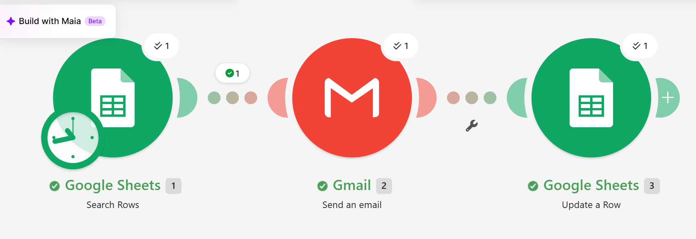
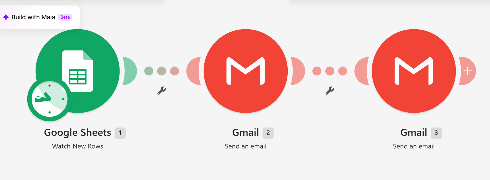
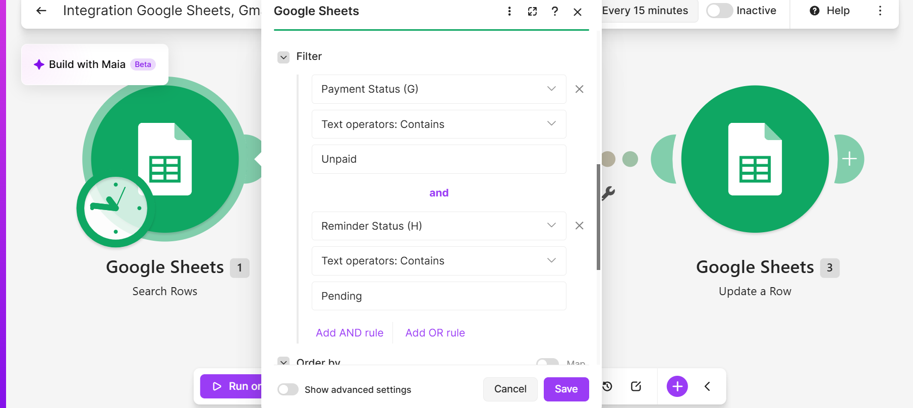
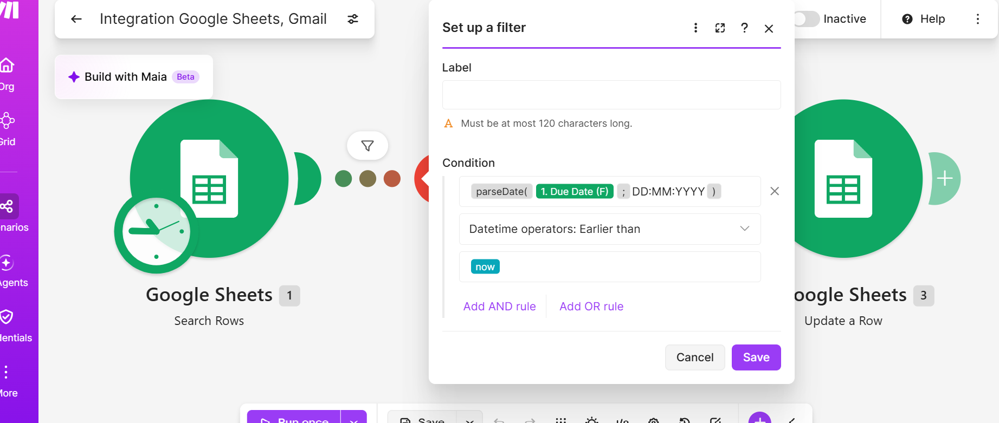
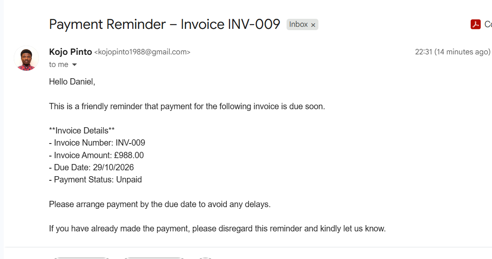
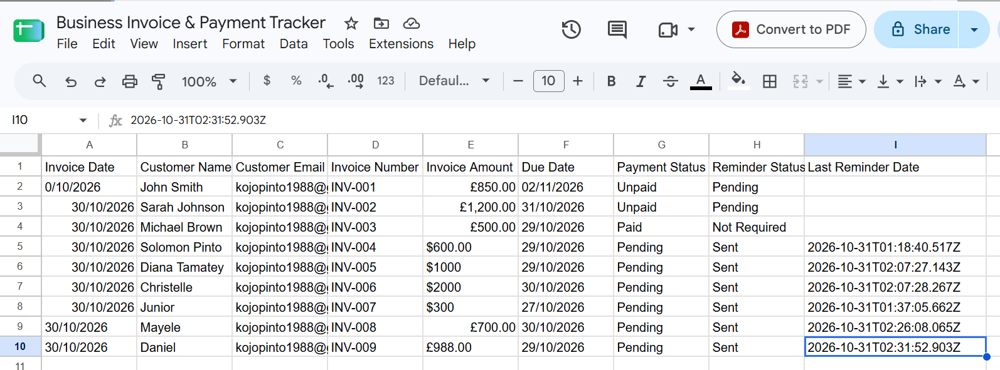
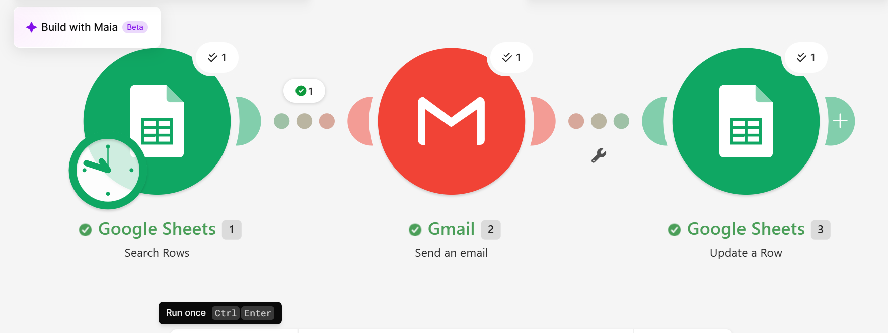

# Invoice & Automated Payment Reminder System

## Project Overview

This project is an automated invoice management and payment reminder system built using Make.com, Google Sheets, and Gmail.

It helps businesses manage customer invoices, track payment statuses, and automatically send reminders when payments become overdue.

The system reduces manual follow-ups, improves payment tracking, and helps businesses maintain better communication with customers.

## Tools & Technologies

- Make.com – Workflow automation
- Google Sheets – Invoice database and payment tracking
- Gmail – Automated customer emails and business notifications

## Key Features

1. **Invoice Confirmation:** Automatically sends customers an email confirming that their invoice has been recorded.
2. **Business Owner Notification:** Notifies the business owner when a new invoice is added.
3. **Invoice Tracking:** Maintains invoice details, payment status, due dates, and reminder history.
4. **Overdue Invoice Detection:** Identifies invoices that are unpaid and past their due dates.
5. **Automated Payment Reminders:** Sends payment reminder emails to customers with overdue invoices.
6. **Reminder Tracking:** Updates the reminder status and records the date of the last reminder.

## Workflow Overview

### Scenario 1: Invoice Confirmation & Owner Notification

1. A business owner or staff member enters invoice details into Google Sheets.
2. Make.com detects the new invoice.
3. Gmail sends an invoice confirmation to the customer.
4. Gmail sends a notification to the business owner.

### Scenario 2: Automated Invoice Payment Reminders

1. Make.com searches Google Sheets for invoices marked Unpaid and Pending.
2. A filter checks whether the invoice due date is earlier than the current date.
3. Gmail sends a payment reminder to the customer.
4. Google Sheets updates the Reminder Status to Sent.
5. The Last Reminder Date is recorded.

## Business Benefits

- Reduces manual invoice follow-ups.
- Helps businesses identify overdue payments.
- Improves customer communication.
- Reduces repetitive administrative work.
- Provides a centralized invoice tracking system.

## Limitations

- Invoice information is entered manually.
- Payment status must be updated by the business.
- The current version sends automated email reminders but does not process payments.
- The system is designed around a single reminder status rather than a multi-stage reminder schedule.

## Screenshots

### 1. Invoice Confirmation Scenario

### 2. Automated Payment Reminder Scenario

### 3. Invoice Search Filter

### 4. Overdue Date Filter

### 5. Payment Reminder Email

### 6. Google Sheets Invoice Tracker

### 7. Successful Test Run

## Future Improvements

- Integrate payment gateways.
- Add multiple reminder stages.
- Generate invoices automatically as PDF documents.
- Introduce payment confirmation automation.
- Develop a business dashboard for monitoring outstanding invoices.

## Author

**Solomon Pinto**

MS Data Analytics | IT Support | Business Process Automation | AI Automation
